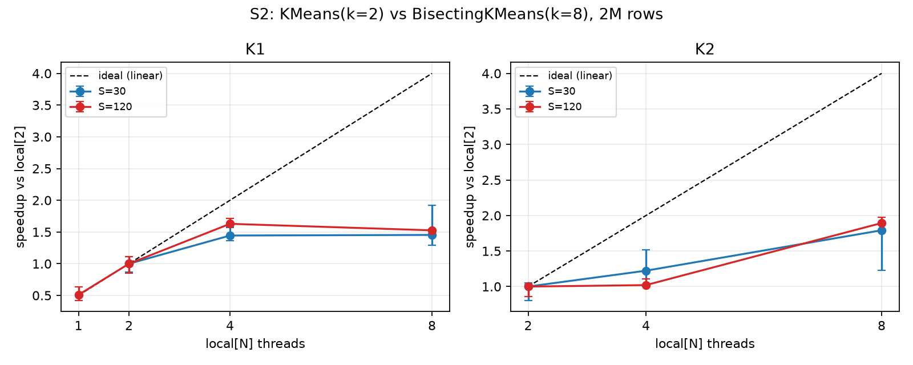

# CS5488 Group 101 — NYC For-Hire Vehicle Trip Analytics on a Single Machine

Course project for CS5488 (Group 101). We analyse **471,960,468 NYC for-hire-vehicle trips**
(2023-01 to 2024-12) end to end on one Windows laptop with PySpark `local[*]`: data
validation, BI aggregation, Isolation Forest anomaly detection with SHAP attribution, and
KMeans behavioural clustering with a stability check. A separate scaling study measures how
many cores each stage actually benefits from.

**Team:** Yuebin Gong, Shiyin Chen



## Results at a glance

| What | Result |
|---|---|
| Trips downloaded / kept | 471,960,468 → 467,142,106 (99.0%) after flag filtering |
| Working sample | 46,706,095 trips (stratified 10%) |
| Anomalies flagged | **13,577** (0.291% of 4,672,734 scored), empirical IQR threshold −0.1664 |
| Cluster count | **K = 2**, silhouette 0.2198, selected by 10/10 seeds; bootstrap ARI 0.96 ± 0.03 |
| Cluster A `short_high_tip` | 9,791 trips (72.1%): median fare $134.69, 34.4 mi, 59 min, tip rate 20.6% |
| Cluster B `long_low_tip` | 3,786 trips (27.9%): median fare $210.90, 62.5 mi, 88 min, zero tip on 56.3% |
| SHAP drivers | `log_tips` > `speed_mph` > `log_fare` in both clusters (Spearman ρ = 0.983) |
| Parallel study | KMeans(k=2) `local[4]` 1.44–1.63×; BisectingKMeans(k=8) `local[8]` 1.79–1.89×; IF scoring `n_jobs=8` 4.38× |

The organising constraint is the one the assignment is built around: an 11.6 GB / 471 M-row
dataset has to be processed end to end on a single laptop-class machine, so every stage is a
Spark job rather than a pandas script.

## Repository layout

```
.
├── README.md                     # this file
├── requirements.txt              # Python dependencies
├── project/
│   ├── README.md                 # full technical walkthrough: methods, numbers, limitations
│   ├── code/                     # 55 Python files (44 live, 7 legacy checks, 4 superseded)
│   └── data/
│       ├── README.md             # what is tracked here and what must be regenerated
│       ├── log/                  # run logs; provenance for every number in the report
│       └── output/               # small artefacts: tables, figures, scaling evidence
├── report/
│   ├── main.tex                  # report source (figures are read from project/data/output)
│   └── main.pdf                  # compiled report
└── requirement/                  # assignment brief, marking sheet, cover/report templates
```

`project/README.md` is the authoritative technical document. It records the execution chain,
the K-selection argument, the parallel strategy, the known limitations, and a provenance map
from every reported number to the file that produced it.

## Quickstart

Requires Python 3.11+ (tested on 3.14) and Java 17+ for PySpark 4. The full pipeline is
CPU-only; no cluster and no GPU are needed.

```bash
python -m pip install -r requirements.txt

# 1. download the 24 monthly TLC files (11.6 GB)
python project/code/download.py

# 2. clean, profile, and build the BI aggregate layers
python project/code/preprocessing/preprocessing.py
python project/code/preprocessing/eda_and_profiling.py

# 3. stratified 10% sample -> Isolation Forest + SHAP -> clustering labels
python project/code/ml/pipeline/01_sample_v2.py
python project/code/ml/pipeline/02b_isolation_forest_shap_rowkeyed.py
python project/code/ml/pipeline/03_kmeans_cluster_anomalies.py     # legacy single-fit labels
python project/code/ml/analysis/10_robust_clustering_rowkeyed.py   # authoritative K sweep + labels
python project/code/ml/pipeline/04_rename_clusters.py              # numeric ids -> business names

# 4. summaries and figures
python project/code/ml/analysis/05_cluster_money_summary.py
python project/code/ml/analysis/11_final_shap_plots.py
python project/code/ml/pipeline/06_plot_cluster_viz.py
python project/code/ml/analysis/08_feature_viz.py

# 5. optional: regenerate the scaling figures/checks from the persisted CSVs (no Spark)
python project/code/ml/experiments/parallel_scaling/run_scaling_study.py --analysis-only
```

Every script resolves the project root from its own location (`Path(__file__).resolve().parents[n]`),
so scripts can be launched from anywhere.

## What is not in the repository

Raw and intermediate data are too large for GitHub and are regenerated by the pipeline. The
directories, their sizes, and the script that recreates each one are documented in
[`project/data/README.md`](project/data/README.md) and in section 3.1 of
[`project/README.md`](project/README.md). Every excluded directory keeps a small `README.md`
placeholder, so the folder structure is still visible on GitHub and each folder states how it
is rebuilt.

| Not tracked | Size | Rebuild with |
|---|---|---|
| `project/data/parquet/` | 11.6 GB | `project/code/download.py` |
| `project/data/output/cleaned/` | 16 GB | `project/code/preprocessing/preprocessing.py` |
| `project/data/output/sampled_km/` | 800 MB | `project/code/ml/pipeline/01_sample_v2.py` |
| `project/data/output/bi_aggregates_compact/` | 558 MB | `project/code/preprocessing/bi_aggregation.py` |
| `project/data/output/if_results_rowkeyed/full_scores_rowkeyed/` | 172 MB | `project/code/ml/pipeline/02b_isolation_forest_shap_rowkeyed.py` |
| `project/data/output/kmeans_full_result/` | 817 MB | `project/code/ml/experiments/kmeans_full.py` |

The scaling study's 2 M-row subset is tracked (≈35 MB) so the analysis can be re-run without
downloading the 11.6 GB release.

## Report

The compiled report is [`report/main.pdf`](report/main.pdf); the source is
[`report/main.tex`](report/main.tex). Figures are read from `../project/data/output/`, so the
report can be recompiled from a fresh clone with `latexmk -pdf main.tex` inside `report/`.

## Team contributions

| Member | Contribution |
|---|---|
| Yuebin Gong | Data download and validation, Spark pipeline and aggregate tables, stratified sampling, Isolation Forest and SHAP, clustering and stability analysis, parallel scaling experiments, manuscript (Part I and Part III) |
| Shiyin Chen | BI data preparation and analysis (Part II), BI figures and visualisation, manuscript review |

## Data source

NYC Taxi & Limousine Commission, For-Hire Vehicle Trip Records (FHVHV), 2023-01 to 2024-12:
<https://www.nyc.gov/site/tlc/about/tlc-trip-record-data.page>. The data is public; the code in
this repository is submitted as coursework for CS5488.
